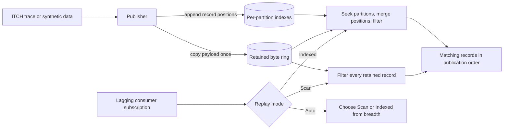
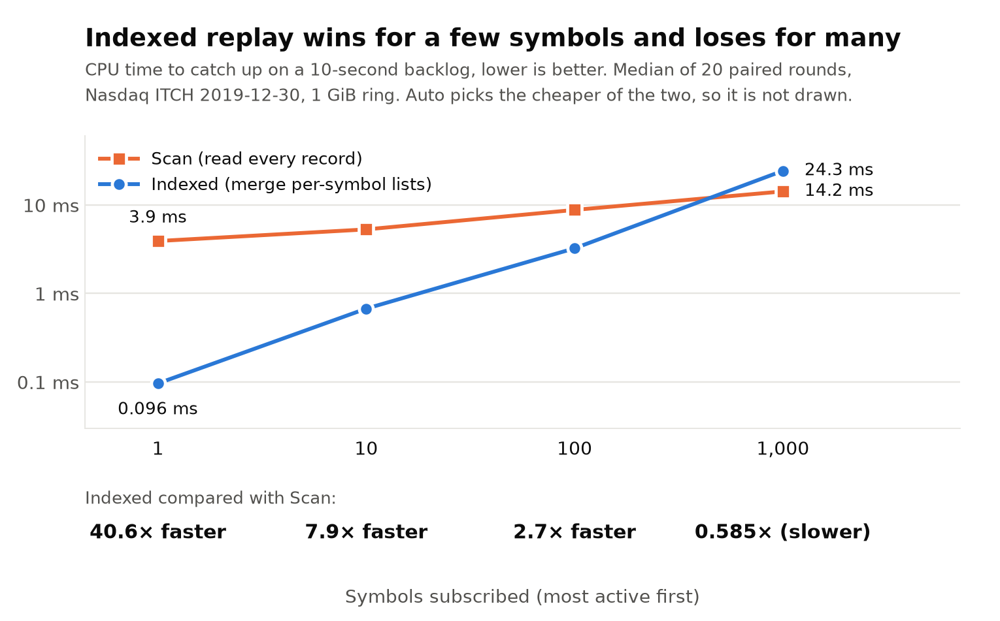
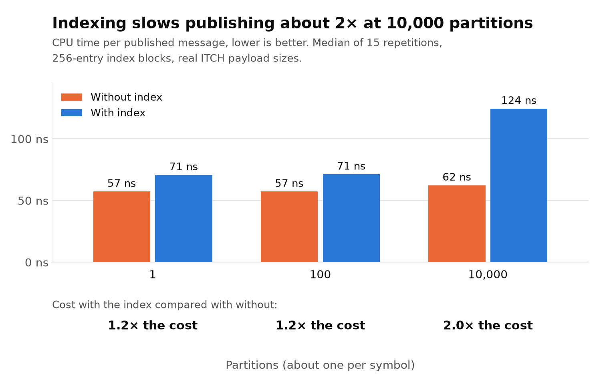

# TipIndex: indexed replay for a market-data message bus

**A single-threaded C++20 pub/sub retained log with per-partition indexes, so a lagging consumer catches up on one symbol without re-reading the whole stream, plus an offline layout optimizer, measured on Nasdaq ITCH data, including where indexing loses.**

Independent implementation motivated by Jane Street's message-bus article; no production claim. Source namespace: `tiplog`.

## Problem and result at a glance

- **Problem.** A market-data bus keeps a recent window in memory. A consumer that fell behind and wants one symbol makes the server filter every retained message, burning CPU.
- **Approach.** Keep record positions per partition (messages sharing the first two topic segments, in practice one symbol). Seek the wanted lists and merge back into publication order (**Indexed**), or filter everything (**Scan**). **Auto** chooses.
- **Headline, a trade-off:** one active symbol takes **3.92 ms** (Scan) vs **0.096 ms** (Indexed) of CPU, **40.6x** less. At 1,000 symbols Indexed **loses** (Scan/Indexed **0.585x**). The publisher pays **124.4 vs 62.3 ns/message** at 10,000 partitions.
- **Scope:** single laptop, one trading-day window, historical timings.

## How it works



The ring is a fixed-size circular byte buffer that overwrites the oldest data. A replay captures a range `(after_seq, upper_seq]` and returns matches in order. Evicted data gives an explicit `HistoryExpired` or `FellBehind`. Design: [docs/ARCHITECTURE.md](docs/ARCHITECTURE.md).

## Results

| Question | Result (CPU time) | Scope |
|---|---|---|
| Does indexing help? | One active symbol: 3.92 ms vs 0.096 ms; Scan used 40.62x CPU (95% CI 39.45 to 41.69) | 10 s backlog |
| When does it stop helping? | 1,000 symbols: Scan/Indexed 0.585 (0.581 to 0.593); Indexed loses | Same setup |
| What does the publisher pay? | 124.4 vs 62.3 ns/message, index on vs off, 10,000 partitions | Microbenchmark, 15 repetitions |
| Can a long search yield? | 1,000,000 records: 1 poll, 17.348 ms vs budget 1,000: p99 29.957 us per poll, 18.366 ms total | Traversal bound, not a deadline |
| Can layout cut reads? | 27.9% fewer **modeled** weighted read bytes (19,367,265,136 to 13,964,962,856) | Modeled, not measured I/O |

Worked example: Scan walks 184,550 retained records; Indexed fetches 1,573 candidates. An independent before/after check of source builds saw paired ratios from 0.939 to 1.775 on small fixtures; no regression or improvement is claimed (independent audit, in git history).

<br>*Catch-up cost by number of symbols subscribed. Data: [chart-data.csv](docs/readme/chart-data.csv).*

<br>*Publishing cost per message, with and without the index.*

Polling chart: [poll-budget-responsiveness.svg](docs/readme/poll-budget-responsiveness.svg). Full reports and per-run data are not in this snapshot; they are preserved in git history at commit `5425335`.

## What was built

- Python ITCH converter, analysis and figures (`py/`).
- C++ engine: ring, partition index, merge kernels, Scan/Indexed/Auto (`src/tiplog/`), with a trace driver and benchmarks.
- Offline layout optimizer: exact dynamic program checked against enumeration, plus greedy heuristics.
- Oracle tests, fuzzing, audit.

## How it was measured and checked

Paired fresh-process rounds (Scan and Indexed back-to-back), one pinned core, 95% bootstrap intervals, every timed output checked against an independent oracle. This snapshot passes 230 CTests (Release and ASan/UBSan builds) and 279 Python tests. The independent audit (in git history) also records 108 M differential operations and 14 findings, all fixed (bounded, not proof of no defects). Method: [docs/METHODOLOGY.md](docs/METHODOLOGY.md).

**Honest limits.** One laptop (Intel Core i5-1235U), one trading day (2019-12-30), one 09:30-10:00 window of 32,817,244 records. Timings come from the 24-25 October 2026 study and describe the pre-remediation source; no fresh campaign is claimed. CPU frequency was not fixed. Intervals describe run-to-run variation on this machine, not variation across trading days. Consumer workloads and the layout cost model are assumptions.

## Quick start

Needs Linux x86-64 (x86-64-v3), CMake 3.30+, GNU Make, C++20 GCC, Python 3, and network or cached dependencies ([hashes](cmake/deps.cmake)). No dataset needed.

```bash
cmake --preset release
cmake --build --preset release --parallel 4
ctest --preset release --output-on-failure
```

No-data demo (expect `correctness: "passed"`, 0 deliveries; timings are smoke diagnostics):

```bash
demo_dir=$(mkdir -p build/f01 && mktemp -d build/f01/readme-XXXXXX)
build/release/tiplog_poll_bench --records 10000 --cases no-match \
  --modes scan --budgets legacy,1000 --reps 1 --output "$demo_dir/poll.jsonl"
python3 -m json.tool --json-lines < "$demo_dir/poll.jsonl"
```

Optimizer example: `build/release/tiplog_layout_example`. Python environment: `python3 -m venv .venv && .venv/bin/python -m pip install --only-binary=:all: -r py/requirements.txt`.

## Benchmarks and CPU tuning

- Timed work is pinned to CPU 2 (a P-core), SMT sibling idle, AC power, saved quiescence record.
- Runners [run_p5_pilot.py](scripts/run_p5_pilot.py) and [run_p6_campaigns.py](scripts/run_p6_campaigns.py) are hash-locked and refuse to run after source edits.
- The full campaign took about 25 hours and 7 GB+; raw ITCH data is local-only.
- Optional CPU tuning (sudo): [docs/METHODOLOGY.md](docs/METHODOLOGY.md).

## Repository map

| Path | Contents |
|---|---|
| [src/tiplog/](src/tiplog/) | Engine, ring, index, merge kernels, [layout library](src/tiplog/layout/) |
| [tools/](tools/), [bench/](bench/), [tests/](tests/) | Trace driver, benchmarks, tests and oracles |
| [py/](py/), [scripts/](scripts/), [configs/](configs/) | Conversion, analysis, runners, experiment matrices |
| [docs/](docs/) | Architecture, methodology and result charts |

## Scope and limitations

- Not built: networking, concurrent readers, durability, crash recovery. The sample lacks the session terminator (`incomplete=true`).
- Not Aria; not comparable to Jane Street's production numbers (different data, hardware, workload). [Article](https://blog.janestreet.com/scaling-and-benchmarking-a-critical-message-bus/).

## Further reading

[ARCHITECTURE](docs/ARCHITECTURE.md) | [METHODOLOGY](docs/METHODOLOGY.md)
