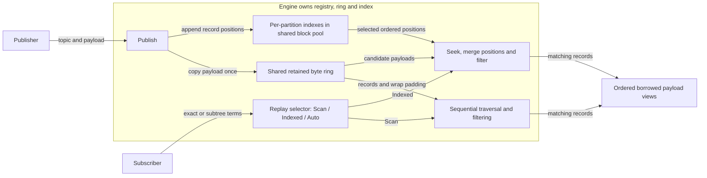
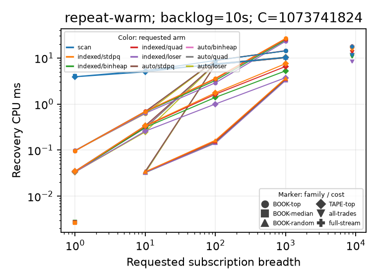
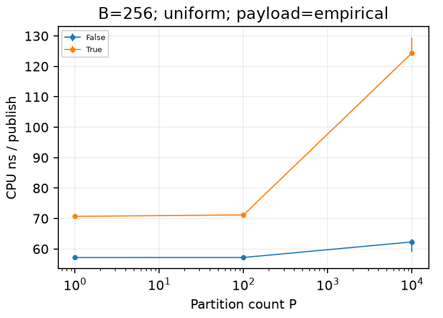
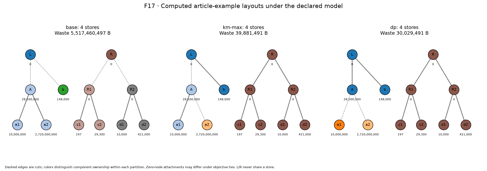

# tiplog — bounded replay and storage-layout experiments

tiplog is a single-threaded, in-process C++20 publish/subscribe log with selective replay, plus a separate offline optimizer for modeling topic-to-store layouts.

A lagging market-data consumer may need only one instrument’s order updates, yet catching up by filtering the whole retained stream spends CPU on unrelated messages. Indexing can avoid that work, but adds publication and memory costs; broad subscriptions may be cheaper to scan. This project investigates those competing costs using Nasdaq ITCH binary market data and synthetic workloads. It is an independent implementation motivated by the [message-bus problem described in the research ledger](docs/plan/RESEARCH.md), with no documented exchange deployment or production adoption.

The engine retains one shared payload copy in a bounded byte ring. Topic subscriptions select partition indexes, and merging their record positions restores publication order. Replay captures a fixed range; live Tail readers chain ranges. Optional inspection budgets let a caller split traversal across turns. The optimizer independently asks how connected groups of topics affect modeled read costs; it does not write stores or configure the engine.

The evidence demonstrates selective-replay savings alongside broad-replay losses, a polling responsiveness/overhead tradeoff, and exact layout improvements under declared consumer assumptions. Historical measurements and later source validation are distinguished below. Start with the [results](#results-and-their-limits), [quickstart](#build-and-try-it), [public API](src/tiplog/engine/engine.hpp), or [technical report](docs/report/REPORT.md).



The Engine owns retained storage; both replay paths and Tail read it. Auto chooses a path. The optimizer is separate.

| Question | Recorded result | Evidence boundary |
|---|---|---|
| Does indexing help catch-up? | For one active-symbol book subscription, **Scan used 40.6× the CPU of Indexed**; at 1,000 symbols, Indexed lost (**Scan/Indexed 0.585×**). | Historical 10-second backlog, 1 GiB ring; [engine results](docs/report/results_tip.md). |
| Can a nonmatching search yield? | One million records split into **1,000 calls**, each inspecting at most **1,000** records. | Traversal bound, not a complete-call deadline; [polling study](docs/report/POLL_BUDGET_RESULTS.md). |
| Can layout reduce unnecessary reads? | **27.9% fewer modeled weighted read bytes**, at the same per-symbol store budgets. | Assumed four-role workload, zero per-store-read penalty; [layout results](docs/report/results_layout.md). |

## Engine behavior and design choices

A topic is a slash-separated path, such as `itch/AAPL/modify/executed`. An exact subscription matches that topic; a subtree matches the named topic itself and its present/future descendants. Overlapping terms form a union: each record appears once per subscription. A **partition** groups the first two path segments, usually one symbol. Payloads are opaque bytes; ITCH routing belongs to the data tools.

`open_replay(sub, after_seq, mode)` captures `(after_seq, upper_seq]` and returns matching records in global sequence order. It does **not pin history**. Opening before retained history reports `HistoryExpired`; losing unread history between calls reports `FellBehind`, with a valid delivered prefix. Completed checkpoints advance past filtered records too. Tail chains completed snapshots; caught-up means it observed the current head, and later publication can create more work. Resume the same Replay to finish its snapshot: reopening from a checkpoint captures a new upper bound.

Delivered payload spans borrow ring memory: consume or copy them before the next Engine mutation. The Engine must outlive its readers. Publication and polling cannot execute concurrently.

| Constraint | Decision | Reason | Cost / limitation | Inspect |
|---|---|---|---|---|
| Finite retained history | Whole-record FIFO eviction in a byte ring | Contiguous records, explicit expiry | Bounds retained bytes, not all process memory | [Ring](src/tiplog/ring/ring.hpp) |
| Many subscriptions share data | Store payload once; index positions in pooled blocks | Avoid per-subscriber payload copies | Index metadata/slack; default `ForceEvict` can evict early under pool pressure | [Index](src/tiplog/index/index.hpp) |
| Selectivity varies | Scan filters all records; Indexed merges partition positions, then filters | Skip unrelated partitions | A partition still contains unwanted topics | [Replay](src/tiplog/engine/engine.cpp) |
| No single replay policy wins | Auto checks partition count and candidate-record fraction; wide subscriptions use Scan | Avoid costly broad merges | Thresholds are configurable, workload dependent | [API/config](src/tiplog/engine/engine.hpp) |
| Merge input shapes differ | Standard priority queue, binary heap, 4-ary heap and loser tree | Compare interleaving/burst tradeoffs | No universal winning kernel | [Kernels](src/tiplog/merge/kernels.hpp) |
| Long searches monopolize a turn | Optional inspection-budgeted polling | Yield without matching output | Setup outside cap; repeated work | [Contract](docs/report/POLL_BUDGET.md) |
| Layout search is expensive | Exact solvers plus threshold heuristics | Certify affordable cases; retain feasible alternatives | Caps leave incomplete exact coverage; heuristics can lose | [Layout](src/tiplog/layout/exact.hpp) |

One **inspection** counts one Scan data (`DATA`) or wrap-padding (`PAD`) record, or one Indexed position entry together with its DATA fetch. Rejected candidates count. Opening, seeking, Auto planning, allocation and merge initialization are excluded: the budget is **not a wall-time guarantee**. A finite poll can return `More + InspectionLimit` with empty output; the caller must schedule other work before resuming. Tail shares one allowance across its internal ranges. Finite modes can yield at different checkpoints and expire at different times under interleaved publication; eventual outputs agree while history remains retained.

## Results and their limits

### Indexed recovery saves work selectively

The historical engine study ran on 24–25 October 2026: Intel Core i5-1235U laptop, GCC 15.2, release `-O2 -g -march=x86-64-v3 -DNDEBUG`, pinned to CPU 2. The Nasdaq 30 December 2019 09:30–10:00 trace contains 32,817,244 records. Recovery timing includes opening, seeking, filtering, merging and the output sink; loading, prefill and subscription compilation are excluded. Publishing is paused.

At the 10:00 anchor, with a 10-second backlog, 1 GiB ring and 1,024-entry index blocks, the active-symbol book subscription took median **3.92 ms Scan versus 0.096 ms Indexed/BinHeap**. Scan inspected 184,550 records; Indexed fetched 1,573 candidates. The paired CPU ratio was **40.62**, with a 95% bootstrap interval **39.45–41.69**. For 1,000 symbols it reversed to **0.585 [0.581–0.593]**; Auto selected Scan.

These are 20 paired fresh-process rounds per configuration, with an excluded warm-up; “repeat-warm” times a second identical replay. Intervals describe run variation on this shared laptop, not variation across market days. Frequency deviations were retained; hardware counters were unavailable. [Protocol, source/binary identities and full results](docs/report/results_tip.md), [paired ratios](results/derived/tip-paired-ratios.csv).

**Replay cost versus subscription breadth**



Both axes are logarithmic: requested subscription breadth versus recovery CPU milliseconds. Colors identify requested mode/kernel; shapes identify subscription families, including full-stream. This historical panel uses the configuration above; error bars are bootstrap 95% intervals. Broad selections erase the index advantage. [Original F09 and data manifest](results/figures/p6-figures.json).

**The publisher pays for indexing**



For 256-entry blocks and empirical ITCH payload sizes, the log horizontal axis is partition count; the linear vertical axis is CPU ns/publication. `True` enables the index; `False` disables it. At 10,000 partitions, medians were **124.4 versus 62.3 ns/message**. Error bars use 15 microbenchmark repetitions and bootstrap 95% intervals, not paired recovery rounds. [M2 method/data](docs/report/results_tip.md), [original F08](results/figures/F08_publish_index_cost.png).

The historical Auto policy was trained separately, then frozen at 64 partitions / candidate fraction 1.0 before held-out evaluation. Current API defaults are 64 / 0.25, explicitly initial policy values. Neither establishes an optimal general policy. Saved timings describe their source/binary hashes, not today's implementation. The [full report](docs/report/results_tip.md) covers memory slack and merge sensitivity.

### Polling trades shorter turns for repeated work

The 27 October synthetic study compared legacy and budgeted APIs **on the same feature binary**. With one million nonmatching 16-byte DATA records, no padding and output allowance one, legacy Scan used one poll per process, median **17.348 ms**. Budget 1,000 used 1,000 polls per process, median per-process p99 **29.957 µs**; cumulative polling took **18.366 ms**, and the scheduled drain **18.555 ms**. Shorter turns did not reduce total work or promise a deadline.

**Polling responsiveness and cumulative cost**


Left: logarithmic public-poll p99 in milliseconds. Right (both axes logarithmic): 100,000 nonmatches, four Indexed partitions; victim-service p99 delay in microseconds versus cumulative poll-time/legacy ratio; labels are budgets. Statistics are medians across three fresh processes. Legacy's left-panel p99 has **one sample/process**, versus **1,000** for budget 1,000. Shared-host, unpinned observations have no confidence-bound claim. Caller service uses separate engines; smaller budgets add service/setup overhead. [Data, setup-dominance cases and reproduction](docs/report/POLL_BUDGET_RESULTS.md), [figure manifest](results/f01/figures/final-20261027-v2/manifest.json).

Actual initial/final source comparisons retained slower cases: paired cumulative poll-time ratios reached **1.775** across 32 workloads / three process pairs. A counterbalanced affinity follow-up over eight workloads / ten pairs reached **1.195**. Their cause and universal nonregression remain unestablished. [All comparisons and limitations](audit/independent-20261027T041900Z/PERFORMANCE.md).

### Offline layout optimization models a different cost

The optimizer cuts topic trees into connected stores, without replication or cross-symbol stores. Its inputs are topic volumes and assumed whole-window requests, each charged every touched store’s bytes once. The budget-constrained objective combines weighted read bytes, per-store-read and materialized-store penalties. These are model parameters, not measured I/O costs.

The fixed family split (`H-BASE`) is the baseline. Threshold-greedy `H-KM-min/max` trades optimality for cheaper search. Gray-code enumeration (`ENUM`) tries cut subsets; class-mask dynamic programming (`MASK-DP`) tracks consumer membership and store count, reconstructing the layout. Exact methods certify completed cases only; their resource caps retain unsolved outcomes. A global multiplier sweep certifies supported budgets only when every partition's exact curve is complete. [Model, algorithms and tradeoffs](docs/plan/ARCHITECTURE.md#6-storage-layout-optimization-formal).

On 25 October's deterministic model study, the spec-derived hierarchy with one order-book, execution/trade, auction and status consumer per symbol (W1) reduced weighted read bytes from **19,367,265,136 to 13,964,962,856**: **27.9%** at zero penalties and the baseline's per-partition store budgets. All **8,907** partitions were covered. These use full observed-source volumes, rather than the morning window. Exact coverage is complete for W1–W3; exact-topic workload W0 covers only **3,873/8,907** spec-hierarchy partitions using at least one exact method. Heuristics can lose to baseline when store-read penalties rise; the flat hierarchy's exact-topic baseline already has zero waste. [Results, workload definitions and input identities](docs/report/results_layout.md), [audited summary](results/derived/layout-summary.json).

**Computed layouts at a fixed store budget**



This schematic has no statistical axes: node labels give modeled bytes, dashed edges are cuts, and colors identify store ownership. Each layout uses four stores; L and R are separate partitions. Exact optimization reduces modeled unnecessary reads versus both alternatives; it neither writes stores nor measures disk I/O. [Computed values](results/p7/worked-example.json), [figure gallery](docs/report/results_layout.md#figures-f14f18).

## Correctness evidence and audit scope

The [latest independent audit](audit/independent-20261027T041900Z/REPORT.md), accepted **28 October 2026**, records:

- **230 CTests per preset** in Debug, Release, AddressSanitizer/UndefinedBehaviorSanitizer and fuzz builds; **499 Python package/script cases**. Repeated preset runs are not additional unique tests.
- **108 million** legacy differential operations against independent history/path matching, and **12 million** budget-model operations checking outputs, checkpoints, errors and inspection counts. A separate matched Release cohort checks sanitizer-build parity.
- **10,000 executions on each of four fuzz targets**, plus allocation-failure, exception-retry and payload-lifetime checks. These bounded campaigns do not exhaust possible inputs or failure schedules.
- **10,000 random layout instances per Release/sanitized build**, checking MASK-DP against enumeration for every applicable budget; independent cost evaluators check reconstructed layouts.

Tests exercise boundaries; independent models challenge optimized paths; sanitizers detect exercised memory/undefined behavior; fuzzing broadens inputs; allocation injection checks failure recovery. [Acceptance](audit/independent-20261027T041900Z/acceptance.json) binds commands, binaries and artifacts to a [source freeze](audit/independent-20261027T041900Z/source-freeze.json). Its 14 confirmed findings were fixed and verified, without implying all defects are eliminated. Acceptance applies to that recorded snapshot; preserved historical timings are not new measurements.

## Build and try it

Run from the repository root. The verified path uses Linux x86-64 with **x86-64-v3** CPU support, CMake ≥3.30, GNU Make, a C++20 GCC toolchain and Python 3 for CLI tests. Configure needs upstream access or cached GoogleTest/Google Benchmark archives in `build/downloads`; [dependency hashes](cmake/deps.cmake) are checked. Clang and sanitizer runtimes are needed for the additional presets.

```bash
cmake --preset release
cmake --build --preset release --parallel 4
ctest --preset release --output-on-failure
```

Expect a successful build and 230 passing CTests at the documented snapshot. No dataset or Python package installation is needed for this path.

This no-data engine demo uses a fresh directory under an allowed output root; existing files are refused:

```bash
mkdir -p build/f01
demo_dir=$(mktemp -d build/f01/readme-XXXXXX)
build/release/tiplog_poll_bench --records 10000 --cases no-match \
  --modes scan --budgets legacy,1000 --reps 1 --output "$demo_dir/poll.jsonl"
python3 -m json.tool --json-lines < "$demo_dir/poll.jsonl"
```

Both rows should report `correctness: "passed"`, zero deliveries and 10,000 inspections. Legacy uses one call; budget 1,000 uses ten. Both finish at checkpoint 10,000. Timing fields here are smoke diagnostics, not a reproduction of the historical study.

Recompute the optimizer's small worked example, then inspect the recorded polling evidence:

```bash
build/release/tiplog_layout_example
python3 -m json.tool results/p7/worked-example.json
python3 -m json.tool results/f01/studies/final-20261027/summary.json | less
```

Expect `status: "passed"`, budget four, and modeled waste of **30,029,491 bytes for DP versus 5,517,460,497 baseline**. The last command reads saved measurements. For datasets, hash-locked Python analysis, campaigns and figure regeneration, follow [REPRODUCE](docs/report/REPRODUCE.md) and the [polling protocol](docs/report/POLL_BUDGET_RESULTS.md#reproduce-and-interpret). Raw inputs and large results are local/ignored; a fresh checkout may need them for full regeneration.

## Where to inspect next

| Path | Review purpose |
|---|---|
| [src/tiplog/](src/tiplog/) | Engine/ring/index/merge implementation; independent [layout library](src/tiplog/layout/) |
| [tools/](tools/) and [bench/](bench/) | Trace driver, correctness CLIs and measurement boundaries |
| [tests/ref/](tests/ref/), [tests/unit/](tests/unit/), [tests/layout/](tests/layout/) | Independent oracles, replay contracts, exact-solver checks |
| [py/tiplog_py/](py/tiplog_py/) | Conversion, experiment generation, analysis and figures |
| [docs/report/](docs/report/) and [results/derived/](results/derived/) | Detailed explanations and machine-readable summaries |
| [audit/independent-20261027T041900Z/](audit/independent-20261027T041900Z/) | Findings, acceptance, provenance and unfavorable timing observations |

The sample lacks the BinaryFILE session terminator (`incomplete=true`); exchange-session completeness is unestablished. Assumed consumer workloads and one laptop/day limit generalization. Networking, concurrent readers, durability and crash recovery remain outside scope. The optimizer has no disk writer or engine handoff. See the [contracts](docs/plan/ARCHITECTURE.md) and [validation design](docs/plan/VALIDATION_PLAN.md).

In this managed workspace, use `scripts/git.sh status --short` / `scripts/git.sh diff`; metadata lives in `.tiplog-git/`, with an empty managed `.git/`. [Figure-panel provenance](docs/readme/README.md) documents the README crops; original results remain intact.
