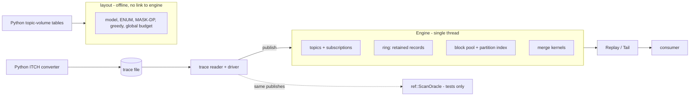

# TipIndex architecture overview

A one-minute map of the design. Results and method: [../README.md](../README.md), [METHODOLOGY.md](METHODOLOGY.md). Code uses the name `tiplog` (namespace `tiplog`).

## Overview

A market-data bus keeps a recent window of messages in memory. A consumer that fell behind and wants one symbol would otherwise make the engine filter every retained message.

The one idea: keep, per partition (messages sharing the first two topic segments, in practice one stock symbol), an index of record positions. Replay then reads only the selected partitions and merges them back into publication order. A Scan fallback (filter the whole range) is kept for broad subscriptions, where indexing loses.

In scope: a single-threaded, in-process C++20 engine and an offline storage-layout optimizer. Not built: networking, concurrency, durability, disk recovery (roadmap only). Measured results and limits: [../README.md](../README.md) and [METHODOLOGY.md](METHODOLOGY.md).

## Component diagram

## Module map

| Module | Where | Owns | Does not do |
|---|---|---|---|
| topics | `src/tiplog/topics/` | Topic registry: path to id, partition, local id | Matching subscriptions |
| subs | `src/tiplog/subs/` | `CompiledSubscription`: per-partition filters, wide flag | Touch the ring or index |
| ring | `src/tiplog/ring/` | Fixed-size circular byte buffer, head/tail, sequence-to-position checkpoints | Know about topics' partitions |
| index | `src/tiplog/index/` | Fixed block pool, per-partition block lists, expiry min-heap | Store payloads |
| merge | `src/tiplog/merge/` | Kernels `StdPQ`, `BinHeap`, `Quad`, `Loser` | Read the ring |
| engine | `src/tiplog/engine/` | `Engine`, `Replay`, `Tail`, Scan/Indexed/Auto selection | Threads, I/O |
| trace, driver | `src/tiplog/trace/`, `src/tiplog/driver/` | Trace reader, ITCH walker, deterministic publish/consume driver | Decide replay results |
| layout | `src/tiplog/layout/` | Cost model, `enumerate`, `mask_dp`, `km_min`/`km_max`, global budget | Write stores or feed the engine |
| tools, bench | `tools/`, `bench/micro/` | CLIs (`tiplog_sim`, `tiplog_bench`, `tiplog_layout`), microbenchmarks | Engine logic |
| oracle | `tests/ref/` | `ScanOracle`, an independent reference | Ship in the library |

Python (`py/tiplog_py/`) holds the ITCH converter, trace writer, analysis and figures.

## How a replay works

1. `Engine::publish` copies the payload once into the ring, assigns the next dense `Seq`, and appends a 4-byte position entry to its partition's block list.
2. Old records are evicted whole from the ring tail; index blocks are freed once all their entries have left the ring.
3. `open_replay(sub, after_seq, mode, kernel)` captures the range `(after_seq, upper_seq]`. If `after_seq + 1` is already older than the oldest retained record, it fails with `HistoryExpired`.
4. Scan walks the range sequentially and filters by topic. Indexed seeks each selected partition's list, merges them by position with the chosen kernel, then fetches and filters each record.
5. Auto picks Scan for a wide subscription, more than `max_partitions` partitions, or when the estimated index entries exceed `max_fraction` of the range. The study used 64 and 1.0, tuned on a separate synthetic seed; `EngineConfig` defaults differ and are uncalibrated.
6. `next_batch` returns `Delivered` views in publication order until `Done`, or stops with `FellBehind` after a correct prefix. `Tail` chains such ranges for a live reader.

## Invariants and guarantees

- Sequence numbers are dense, global and start at 1; log positions are 64-bit and never recycled.
- A replay returns exactly the matching retained records, once each, in sequence order, or fails explicitly. There is no silent loss.
- Scan, Indexed and Auto share one checkpoint and expiry contract and deliver identical outputs.
- Chaining polls equals one replay over the union range.
- Payload views are valid only until the next mutating engine call.
- The engine creates no threads; the absence is deliberate.
- The index never outlives its data: a block is freed only after all its entries are older than the ring tail, so a stale cursor is caught by a minimum-key check.
- The optimizer never writes stores and never feeds the engine.

## Key design decisions

| Decision | Why | Cost or alternative |
|---|---|---|
| One shared ring, payload copied once | Simple, bounded memory, cheap eviction | A mirrored virtual-memory ring was rejected (Linux-specific) |
| Per-partition index on a shared 1,024-entry block pool | Seek to one symbol without reading others | Publisher cost: 124.4 vs 62.3 ns/message at 10,000 partitions |
| Several merge kernels | None wins everywhere: loser tree 11.3 vs BinHeap 19.9 ns/output on interleaved owners; BinHeap 4.5 vs 9.5 on long bursts | Kernel is a parameter |
| Auto falls back to Scan | A 1,000-symbol subscription ran 0.585x (index slower) | Thresholds fixed from a finite training grid |
| Explicit expiry errors, no pinning | Publisher is never blocked by readers | A slow reader must handle `FellBehind` |
| Optional inspection budget on polls | Bounds traversal per call | Not a wall-clock bound; total work can grow |
| Single-threaded core | Reproducible, checkable against the oracle | No concurrency claims |

## Storage-layout optimizer

Offline. It models cutting each symbol's topic tree into connected stores under a store budget. `mask_dp` (class-mask dynamic programming) is checked against exhaustive `enumerate` on 10,000 random trees with 0 mismatches; `km_min`/`km_max` are independent greedy threshold heuristics. It reports modeled read bytes only; no disk I/O is measured.

## Correctness architecture

`ScanOracle` matches by string prefix on topic paths, not engine ids, and models retention independently. Differential tests compare every mode and kernel with it; a Python digest oracle checks the trace alone. Builds run under ASan/UBSan and fuzzers. See [METHODOLOGY.md](METHODOLOGY.md).

## Boundaries and non-goals

- No network service and no concurrent readers or writers.
- No durability, write-ahead log or crash recovery.
- No on-disk store packs; layout results are modeled.
- The ITCH sample is incomplete (`incomplete=true`, no end-of-file marker).

## Where to go deeper

The headers [engine.hpp](../src/tiplog/engine/engine.hpp), [ring.hpp](../src/tiplog/ring/ring.hpp), [index.hpp](../src/tiplog/index/index.hpp), [kernels.hpp](../src/tiplog/merge/kernels.hpp).
