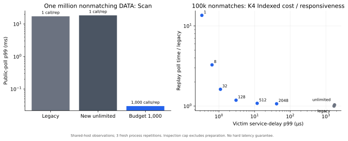
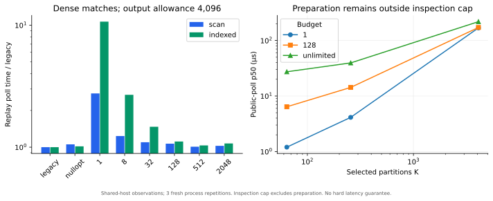
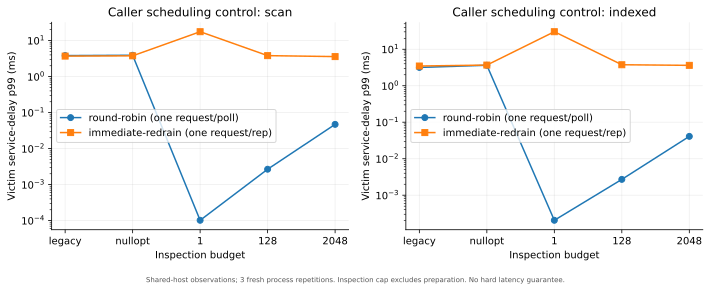

# Work-budgeted polling: measured results

The inspection budget works as intended: a million-record search can return control after each chosen chunk, including when nothing matches. Smaller turns increase total work when the caller repeatedly resumes the reader. Large Indexed selections can spend most of a call preparing cursors, outside the inspection cap.

This study supports keeping the feature **optional**. It supplies a responsiveness control, with no automatic default budget or maximum-duration promise. The [API contract and caller example](POLL_BUDGET.md) describe how to resume and schedule other work.

## Evidence and method

The exact [study plan](../../results/f01/study-plan-final.json) was declared before timing, following the [measurement protocol](../../results/f01/protocol.json). The [completed manifest](../../results/f01/studies/final-20261027/manifest.json) binds every command, original output, derived repetition label, log, source freeze, Release build record and binary identity. The [validated summary](../../results/f01/studies/final-20261027/summary.json) retains all 758 arm groups and their sample counts.

Each job ran in **three fresh processes**, using the same fixture seed and initial arm order. Original tool output always has tool repetition zero. A separately recorded normalizer changes only that field to process repetition 0/1/2 in derived copies; the [normalization map](../../results/f01/studies/final-20261027/normalization.json) binds original and derived paths and hashes. Original outputs remain intact. Percentiles are nearest-rank statistics within each process; reported percentile values are medians of those three process statistics. Observed maxima span all three processes. Ratios to legacy are computed within each process before taking the median.

| Job | Inputs | Accepted rows |
|---|---|---:|
| Million-record example | No match / one final match; Scan, Indexed, Auto; legacy, unlimited, budgets 1 and 1,000 | 72 |
| Budget curve | 100,000 records; no match / sparse; K1/K4; all three modes; all eight API/budget arms | 288 |
| Dense throughput | 100,000 matches; output allowance 4,096; K1/K4; all three modes; all eight arms | 144 |
| Preparation stress | 1,000 records; K64/K256/K4096; all three modes; StdPQ/Quad; five arms | 270 |
| Shapes and kernels | Fixed, variable and wrapped payloads; K4; candidate strides 1/8; Indexed/Auto; all four kernels | 1,440 |
| Caller scheduling | 200,000 nonmatches; Scan/Indexed; round-robin / immediate redrain; five arms | 60 |
| **Total** | **758 distinct arms × three fresh processes** | **2,274** |

Every accepted row passed exact command-to-arm identity checks, finite inspection/output limits, work-counter consistency, the independent publication-time output digest and final captured-range boundary. The separate [benchmark contract checks](../../results/f01/studies/final-20261027/contracts.json) also passed: invalid input rejection, output preservation, resource-limit handling and six corrupted-evidence controls.

Measurements ran on 2026-10-27, approximately 01:35:50–01:36:24 UTC, using GCC 15.2.0, Release `-O2 -g -march=x86-64-v3 -DNDEBUG`, Linux x86-64 and 12 reported logical CPUs. Root-controlled builds, tests and campaigns had finished before timing. The process was unpinned; host frequency/governor/load observations are in each execution record. These are **shared-host observations**, without a quiet-host, hardware-counter or statistical confidence claim. Fixture construction and reader opening are timed separately; public-poll latency includes all preparation inside that call.

`legacy` below means the existing `size_t` API on the **current feature binary**. Comparison with the new unlimited overload measures these two current API paths. It does not establish overhead against the pre-feature implementation. Earlier original-source diagnostics under `results/f01/legacy-diagnostic/` remain exploratory and are excluded from this study's conclusions.

## The million-record example, before and after

This fixture contains exactly 1,000,000 nonmatching, 16-byte DATA records and no PAD. Output allowance is one. All four Scan arms return zero messages and eventually inspect the same million records.

| Scan API / budget | Calls per process | Maximum inspections per call | Poll p99, median across processes | Largest observed poll | Total poll time, median | Full drain time, median |
|---|---:|---:|---:|---:|---:|---:|
| Existing legacy API | 1 | 1,000,000 | 17.348 ms | 17.532 ms | 17.348 ms | 17.349 ms |
| New unlimited API | 1 | 1,000,000 | 18.542 ms | 18.559 ms | 18.542 ms | 18.544 ms |
| Budget **1,000** | **1,000** | **1,000** | **29.957 µs** | **42.307 µs** | **18.366 ms** | **18.555 ms** |
| Budget 1 | 1,000,000 | 1 | 0.067 µs | 116.977 µs | 56.866 ms | 241.913 ms |

For the unlimited rows, each process contributes only **one** poll: its p99 is that one observation. Budget 1,000 contributes 1,000 polls per process; budget one contributes a million. Timer overhead is material for very short calls. The maximum observed budget-one call exceeds the budget-1,000 maximum, illustrating why an inspection count is not a wall-clock guarantee.

In plain terms, the existing API occupied the worker for about 17 ms in one turn. Budget 1,000 split the same search into 1,000 turns, with observed per-process p99 around 30 µs, while its complete scheduled drain took about 18.6 ms. Budget one created many more scheduling opportunities and much more total overhead. Its full drain includes a million victim-reader and publisher services, compared with one service each for the legacy arm.

Indexed showed the same functional split: the legacy API's single poll had median 15.707 ms; budget 1,000 had median per-process p99 28.156 µs and total poll time 16.063 ms. Auto chose Scan for this fixture because all records belong to selected partitions. In the final-match fixture, budget 1,000 takes 1,001 calls: the successful final delivery stops at the output boundary, and the following call confirms completion. That preserves the established output-boundary behavior.

The new unlimited route had a paired median poll-time ratio of 1.068 to legacy in this Scan example, and 1.020 in Indexed. These observed API-path costs remain visible; no assertion of zero overhead is made.



## The budget is a tradeoff

For 100,000 nonmatching records, four selected partitions, Indexed/StdPQ and output allowance one:

| Inspection budget | Calls per process | Poll p99, median | Total poll time, median | Paired poll-time ratio to legacy | Index seeks |
|---|---:|---:|---:|---:|---:|
| Legacy | 1 | 1,690.922 µs | 1.691 ms | 1.000× | 4 |
| New unlimited | 1 | 1,746.613 µs | 1.747 ms | 1.035× | 4 |
| 1 | 100,000 | 0.297 µs | 22.970 ms | 13.558× | 400,000 |
| 8 | 12,500 | 0.612 µs | 5.524 ms | 3.267× | 50,000 |
| 32 | 3,125 | 1.063 µs | 2.754 ms | 1.620× | 12,500 |
| 128 | 782 | 2.947 µs | 2.001 ms | 1.183× | 3,128 |
| 512 | 196 | 11.804 µs | 1.830 ms | 1.083× | 784 |
| 2,048 | 49 | 41.481 µs | 1.796 ms | 1.069× | 196 |

This forms a responsiveness/cost curve rather than a universal best budget. Reconstructing the Indexed cursors each turn explains the repeated seeks. The full drain also includes the caller's service work, output hashing and measurement overhead; the table separates cumulative public-poll time from that larger cost.

Dense matching does not remove the tradeoff. With 100,000 matches, K4 and output allowance 4,096, Indexed's median cumulative poll times were 2.141 ms for legacy, 2.218 ms at budget 512, 2.388 ms at budget 128 and 22.877 ms at budget one. Corresponding paired ratios were 1.033×, 1.112× and 10.702×. All returned the same 100,000 ordered messages. Callers focused only on fastest catch-up should retain the unlimited path or choose a sufficiently large allowance from their own workload measurements.

## Preparation can dominate

The inspection budget excludes seeking, cursor construction and merge preparation. For 1,000 nonmatches in Indexed/StdPQ with budget one:

| Selected partitions | Poll p50, median | Poll p99, median | Cumulative index seeks | Total poll time, median | Paired time ratio to legacy |
|---|---:|---:|---:|---:|---:|
| 64 | 1.199 µs | 1.429 µs | 64,000 | 1.211 ms | 43.940× |
| 256 | 4.125 µs | 6.697 µs | 256,000 | 4.137 ms | 105.260× |
| 4,096 | 168.553 µs | 194.080 µs | 4,096,000 | 170.260 ms | 823.037× |

At K4096, budget 128 still had median poll p50 171.504 µs, close to budget one's 168.553 µs: preparation overwhelms the difference in traversal. The legacy API finished its whole 1,000-record range in median 208.165 µs. Auto chooses Scan above its existing partition threshold and avoids this explicit Indexed preparation pattern. These results support the approved traversal-only scope limitation and do not justify claiming a bounded complete call.

All wrapped-variable arms contained one internal PAD. Scan charged it; Indexed's candidate accounting charged its selected postings instead. Candidate stride eight exercised Auto choosing Indexed, while stride one exercised its Scan fallback. Fixed/variable payloads and every merge kernel preserved the oracle output.

A separate resource control accepted K8192 at a reported fixture subtotal of 101,851,965 bytes and rejected K12288 before timing because its estimate exceeded 128 MiB. Both outcomes and the expected nonzero process exit are preserved in the [resource control output](../../results/f01/studies/final-20261027/resource-boundary.jsonl). This brackets tested points; the exact highest feasible K was not searched. Accepted timed fixtures stayed below 50,987,837 reported bytes. The cap covers ring/checkpoint storage, exact reserved index bytes and a conservative topic allowance; allocator overhead, per-call temporary readers and telemetry arrays are outside that subtotal. Process peak RSS is reported separately; the largest observed value in the accepted timed processes was 52,727,808 bytes.



## The caller must give other work a turn

The round-robin experiment makes one short victim-reader request and one publisher request eligible immediately before each long-reader poll. It serves them after that call. Separate service engines keep the primary captured history immutable. In the immediate-redrain control, one pending request of each kind waits until the long replay finishes.

For 200,000 Scan nonmatches and budget 128, the round-robin victim's median per-process p99 delay was **2.674 µs** across 1,563 requests per process. Immediately redraining the same reader delayed its single pending request for median **3.817 ms**. The latter “p99” is the one observation in each process. This demonstrates the scheduling opportunity and the need to use it.

Round-robin arms perform different numbers of service operations as their poll counts differ. This is a fixed-policy scheduling example, not equal offered-load service-level benchmarking. Publication on a separate engine does not measure shared-engine retention pressure or concurrent operation.



## Reproduce and interpret

Original benchmark output is never overwritten. Choose a fresh destination directory for another execution:

```sh
PYTHONDONTWRITEBYTECODE=1 python3 scripts/run_f01_study.py run \
  --plan results/f01/study-plan-final.json \
  --freeze results/f01/source-freeze-final.json \
  --build-record results/f01/checks/final2-build-release-20261027T012424.459838Z.json \
  --destination results/f01/studies/NEW-NAME

MPLCONFIGDIR=build/matplotlib PYTHONDONTWRITEBYTECODE=1 .venv/bin/python \
  scripts/plot_f01_study.py \
  --summary results/f01/studies/NEW-NAME/summary.json \
  --output-dir results/f01/figures/NEW-NAME
```

The runner rejects changed frozen C++ sources, a mismatched build record or changed protocol/analysis inputs. It retains raw non-ok outcomes and stops on an unexpected failure. The [figure manifest](../../results/f01/figures/final-20261027-v2/manifest.json) binds plotted selections, repetition/sample counts and SVG/PDF hashes. The earlier figure directory remains preserved; v2 changes labels and titles only.

The study measures static Replay performance. Tail rollover, eviction, lifetime and exception behavior are correctness-test concerns elsewhere in F-01; no live-Tail timing conclusion follows from these numbers. Three process repetitions, fixed arm order, warm OS caches and one shared host do not establish a deployment default, a universal speedup or a maximum latency. Selecting a cap remains an explicit caller decision based on its scheduling needs and observed preparation costs.
